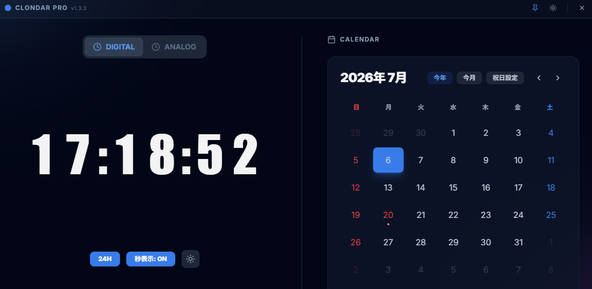

# 🕒 Clondar

**English** | [日本語版](./README_JA.md)

<!-- UPDATE 2026-06-21: Translated main README to English and linked to README.ja.md under multi-language structure. -->

**Clondar** is a modern desktop widget-type clock & calendar application that strikes an ultra-minimal look with a transparent, borderless, and shadowless design blending natively into your Windows desktop.

Powered by Tauri v2, it operates with extremely low resource consumption, stays "Always on Top" if desired, and lets you check your schedules and time in a beautiful, streamlined view.

## 📄 License

This project is licensed under the GNU General Public License v3.0 or later (GPL-3.0-or-later) - Copyright (c) 2026 tkshnkgwr. See the [LICENSE](LICENSE) file for details.
