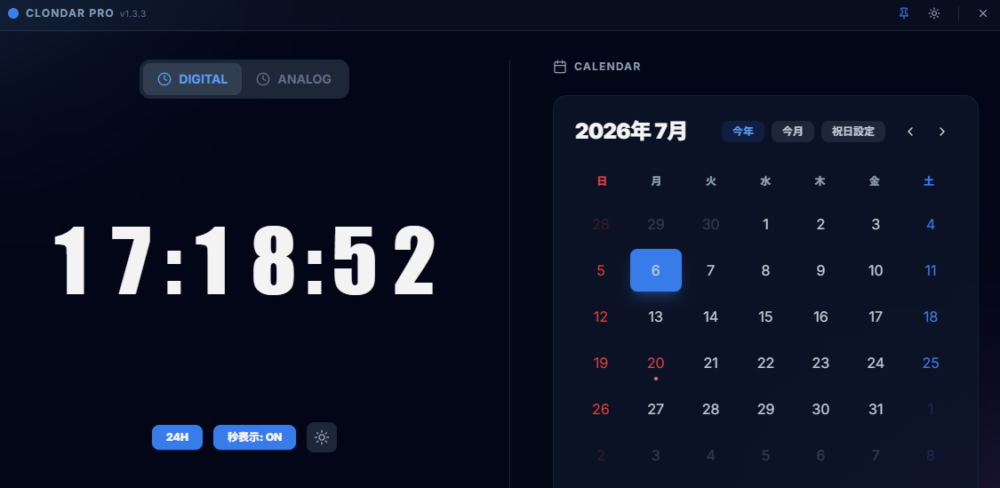

# 🕒 Clondar Pro

**English** | [日本語版](./README_JA.md)

[](https://github.com/tkshnkgwr/clondar/actions)
[](https://github.com/tkshnkgwr/clondar/actions)
[](https://github.com/tkshnkgwr/clondar/releases)
[](https://www.rust-lang.org/)
[](https://nodejs.org/)
[](https://v2.tauri.app/)
[](LICENSE)

**Clondar Pro** is an ultra-minimal desktop widget clock & calendar application that seamlessly blends into your Windows desktop with transparent, borderless, and shadowless styling.

Powered by Tauri v2, it operates with extremely low resource consumption (approx. 30–55 MB RAM), stays "Always on Top" if desired, and lets you check your schedules and current time in a streamlined, distraction-free view.



---

## ✨ Features

- **Desktop-Integrated Minimalist Design (Borderless & Shadowless)**:
  - Eliminates all default OS window borders and title bars, with Windows native shadows physically disabled.
  - Background transparency toggle (☀️) instantly applies a sleek glassmorphic blur canvas.
  - Seamless window dragging anywhere across the widget via `data-tauri-drag-region`.
- **Clock Section**:
  - **Digital Clock**: Monospaced tabular digits (`Impact` typeface) prevent jitter during seconds updates. Supports 12H/24H format and seconds ON/OFF toggling.
  - **Analog Clock**: Smooth sweep-second hand motion calibrated with millisecond precision.
  - **Theme Toggle**: One-click instant switching between Light and Dark themes.
- **Calendar Section**:
  - **Fixed 6-Week Grid**: Locked 42-day calendar layout guarantees zero widget dimension jumping between months.
  - **Full Japanese Holiday Support**: Accurate computation of fixed dates, Happy Mondays, Emperors' Birthdays, astronomical Equinoxes, substitute holidays, national bridge days, and special overrides.
  - **Yearly View**: Full-screen modal presenting all 12 months with smooth previous/next year pagination.
- **Holidays Manager**:
  - Visual editor to add, inspect, and remove custom fixed holiday definitions.
  - Visual line-by-line diff comparison against default rules powered by `common_lib`'s LCS algorithm.
  - Keyword frequency statistics (e.g. occurrences of specific holiday keywords).
  - One-click restore to built-in factory defaults.
- **Help & App Info Modal (❓)**:
  - Quick-access guide modal presenting dynamic version badge and operational cheat sheets.
- **System Tray Residence**:
  - Closing the widget safely minimizes it to the Windows system tray without terminating the process.
  - Right-click tray menu provides "Show / Hide", "Always on Top", "Reset Position", and "Quit".
- **DPI-Aware Coordinate Restoration & Startup Guard**:
  - Preserves absolute physical coordinates across multi-monitor setups.
  - Built-in startup protection lock (`isRestoringRef`) prevents race conditions and accidental coordinate overwrites.
- **Offline Complete**:
  - Zero external CDN or internet dependencies; runs 100% offline out-of-the-box.

---

## 🖥️ System Requirements

| Item                  | Requirement                                                           |
| :-------------------- | :-------------------------------------------------------------------- |
| Supported OS          | Windows 10 / 11 (64-bit)                                              |
| Runtime               | Microsoft Edge WebView2 Runtime (Pre-installed on Windows 10/11)      |
| Recommended Dev Tools | Node.js v26.4.0+, Rust 1.96.0+                                        |

---

## 🚀 Quick Start & Key Controls

### Keyboard & Mouse Controls

| Action                    | Behavior                                                                                |
| :------------------------ | :-------------------------------------------------------------------------------------- |
| **Window Dragging**       | Drag any unoccupied area of the widget to reposition it freely                          |
| **Always on Top (📌)**     | Toggle pinning the window above all other desktop applications                          |
| **Glass Transparency (☀️)**| Toggle background glassmorphism blur effect                                             |
| **Help Modal (❓)**       | Open operational cheat sheets and version specifications                                |
| **Close (❌) / Esc Key**   | Hide window to system tray (closes active modal if one is open without closing the app) |

---

## 🛠️ Development & Build

### 1. Install Dependencies

```powershell
npm install
```

### 2. Start Development Mode (with Hot Reload)

```powershell
cargo tauri dev
```

### 3. Run Automated Tests

```powershell
# Frontend test suite (Vitest)
npm test

# Backend test suite (Rust)
cargo test --manifest-path src-tauri/Cargo.toml
```

### 4. Production Build (MSI / EXE)

```powershell
cargo tauri build
```

---

## 📚 Documentation Index

For comprehensive technical specifications and operational guidelines, refer to the documentation below:

| Document                                                      | Language | Description                                                  |
| :------------------------------------------------------------ | :------: | :----------------------------------------------------------- |
| [Specification (SPECIFICATION.md)](./docs/en/SPECIFICATION.md) | English  | Functional specifications, UI/UX architecture, packaging     |
| [Architecture (ARCHITECTURE.md)](./docs/en/ARCHITECTURE.md)   | English  | Process model, IPC communication, data flow, state persistence |
| [User Guide (USER_GUIDE.md)](./docs/en/USER_GUIDE.md)         | English  | Installation walkthrough, operational cheat sheet            |
| [Development Guide (DEVELOPMENT.md)](./docs/en/DEVELOPMENT.md)| English  | Developer setup, codebase structure, documentation standards |
| [Testing Policy (TESTING.md)](./docs/en/TESTING.md)           | English  | Unit testing workflow, verification scripts, quality checks  |
| [Test Report (TEST_REPORT.md)](./docs/en/TEST_REPORT.md)       | English  | Self-test matrix (34/34 PASS) and Mermaid architecture diagram|
| [Todo Backlog (TODO.md)](./docs/en/TODO.md)                   | English  | Completed features, immediate tasks, and future backlog      |
| [Changelog (CHANGELOG.md)](./docs/en/CHANGELOG.md)             | English  | Version release notes and change histories                   |
| [Release Guide (RELEASE.md)](./docs/en/RELEASE.md)             | English  | Version bumping, tagging, and automated release pipeline     |
| [Contributing (CONTRIBUTING.md)](./docs/en/CONTRIBUTING.md)   | English  | Commit guidelines, PR processes, and development conventions |
| [Security Policy (SECURITY.md)](./docs/en/SECURITY.md)         | English  | Security principles, supported versions, vulnerability reports|
| [Footprint Log (FOOTPRINTS.md)](./docs/en/FOOTPRINTS.md)       | English  | Binary size, RAM usage, and compile performance metrics      |

---

## 📄 License

This project is licensed under the GNU General Public License v3.0 or later (GPL-3.0-or-later) - Copyright (c) 2026 tkshnkgwr. See the [LICENSE](LICENSE) file for details.
