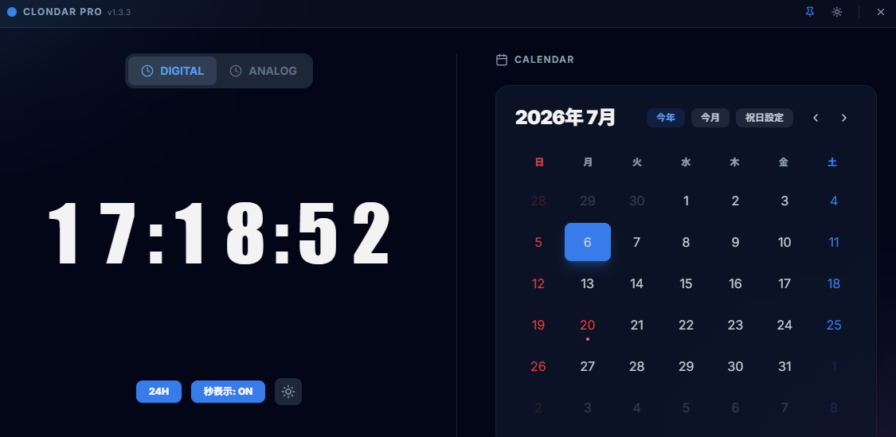

# Clondar Pro (v2.0.0)

[English Version](README.md) | **日本語版**

**Clondar Pro** は、Windows デスクトップに溶け込む「枠なし・影なし・背景透過」のミニマル常駐型時計 ＆ カレンダーウィジェットです。**v2.0.0** からは WebView2 や Node.js を完全に廃し、**Pure Rust (`egui` / `eframe` + `glow`)** による単一プロセス・超軽量ネイティブアプリへ進化しました。



> [!NOTE]
> 旧 Tauri v2 + WebView2 + React 版（v1.4.4）のソースコードは、Git タグ `v1.4.4` および過去コミット履歴に保全されています。

---

## ✨ 主な機能

- **壁紙に溶け込むミニマル UI（枠なし・影なし・透過対応）**:
  - OS 標準のタイトルバーやドロップシャドウを排除し、透過モードとダーク／ライトテーマの切り替えに対応しています。
- **デジタル ＆ アナログ時計 (`clock_pane.rs`)**:
  - **デジタル表示**: 等幅数字レイアウトによる桁ズレのない視認性の高い時刻表示、12H / 24H（AM/PM）切替、秒表示 ON/OFF に対応。
  - **アナログ表示**: 視認性を高めた拡大文字盤と滑らかなスイープ秒針を搭載（アナログ表示中は `24H` ボタンを自動的に操作不可に設定）。
  - モードや表記を切り替えても下部コントロールボタン群の位置が上下にぶれない固定配置を採用。
- **6週間固定カレンダー ＆ Rust 祝日エンジン (`holidays.rs`)**:
  - 月の日数に影響されない **42日（6週間）固定グリッド** により、月切り替え時にウィンドウ高さが変動しません。
  - 固定祝日・ハッピーマンデー・春分/秋分の日・天皇誕生日・振替休日・国民の休日・年別特例を Pure Rust で高速計算し、ホバーツールチップで祝日名を表示します。
  - **年間カレンダー（12ヶ月一覧）** と **祝日設定マネージャー**（UI 編集・生 JSON 直接編集・LCS 変更差分・キーワード集計・初期化・入力検証付き保存）を内蔵。
- **豆腐文字化けゼロのベクターアイコン ＆ 日本語フォント対応**:
  - 絵文字フォントに頼らないカスタムベクター線画アイコン（`icons.rs`）と Windows 日本語フォント読込（`font.rs`）により、どの環境でも安定した表示を実現。
- **システムトレイ常駐 ＆ ローカル完結永続化**:
  - `Esc` キー（モーダル表示中はモーダル優先）または閉じるボタンでトレイ格納。右クリックメニューから表示切替・最前面固定・位置リセット・終了が可能です。
  - Windows Named Mutex（`com.clondar.pro.mutex`）による多重起動防止、および `%LOCALAPPDATA%\com.clondar.pro\state.json` へのローカル状態・座標保存（外部通信ゼロ）。

---

## 📊 軽量化・実機メモリ実測比較 (v2.0.0)

Windows 11 実機での同時比較計測結果（`2026-11-16`）：

| バージョン / 構成                    | プロセス数 | 固有メモリ (Private) |  WorkingSet   | 備考                                               |
| :----------------------------------- | :--------: | :------------------: | :-----------: | :------------------------------------------------- |
| **v2.0.0 / Phase C (`egui + glow`)** |   **1**    |     **68.45 MB**     | **115.76 MB** | Pure Rust OpenGL 構成 (`Clondar.exe`: **4.89 MB**) |
| Phase C 試作 (`egui + wgpu`)         |     1      |      293.06 MB       |   349.54 MB   | DX12 / Vulkan / シェーダコンパイラ DLL の読込負荷  |
| Phase B (`v1.4.4`, Tauri + WebView2) |     7      |      190.74 MB       |   364.81 MB   | WebView2 最適化後のマルチプロセス稼働時            |
| 改良前 (`v1.4.1`, WebView2)          |     7      |      207.51 MB       |   192.17 MB   | 最適化前の旧 Tauri + React 版                      |

* **固有メモリ**: Phase B WebView2 表示中比 **-64.1%（-122.29 MB）**、`wgpu` 試作比 **-76.6%（-224.61 MB）** の大幅削減を達成。
* **パッケージサイズ**: 実行ファイル `Clondar.exe` **4.89 MB**、日英対応 NSIS インストーラー `Clondar_Pro_2.0.0_x64-setup.exe` **2.59 MB**。

---

## 💻 動作環境・開発要件

### エンドユーザー（実行のみ）
- **対応 OS**: Windows 10 / 11 (64-bit)
- **外部ランタイム**: 不要（単体起動可能。WebView2 ランタイムも不要です）

### 開発者（ビルド環境）
- **Rust**: `1.96.0` 以上（`x86_64-pc-windows-msvc`）
- **NSIS (`makensis`)**: インストーラー生成時のみ必要（`installer/clondar.nsi`）
- **共有クレート**: 兄弟ディレクトリ `../common_lib` に [`common_lib`](https://github.com/tkshnkgwr/common_lib) を配置

---

## 🚀 ビルド・検証・パッケージング手順

```powershell
# clondar と同じ親ディレクトリに common_lib をクローン
git clone https://github.com/tkshnkgwr/clondar.git
git clone https://github.com/tkshnkgwr/common_lib.git
cd clondar

# 開発ビルド・起動
cargo run

# 品質チェック・単体テスト一式
cargo fmt --check
cargo clippy --all-targets -- -D warnings
cargo test
cargo doc --no-deps --document-private-items

# 本番リリースビルド (target\release\Clondar.exe を出力)
cargo build --release

# 日英対応 NSIS インストーラー生成 (installer\Clondar_Pro_2.0.0_x64-setup.exe を出力)
makensis installer\clondar.nsi
```

---

## 📖 ドキュメント一覧

| ドキュメント             | 日本語版                                     | English                                      |
| :----------------------- | :------------------------------------------- | :------------------------------------------- |
| **製品仕様書**           | [SPECIFICATION.md](docs/ja/SPECIFICATION.md) | [SPECIFICATION.md](docs/en/SPECIFICATION.md) |
| **アーキテクチャ設計**   | [ARCHITECTURE.md](docs/ja/ARCHITECTURE.md)   | [ARCHITECTURE.md](docs/en/ARCHITECTURE.md)   |
| **ユーザーガイド**       | [USER_GUIDE.md](docs/ja/USER_GUIDE.md)       | [USER_GUIDE.md](docs/en/USER_GUIDE.md)       |
| **開発者ガイド**         | [DEVELOPMENT.md](docs/ja/DEVELOPMENT.md)     | [DEVELOPMENT.md](docs/en/DEVELOPMENT.md)     |
| **リリース手順書**       | [RELEASE.md](docs/ja/RELEASE.md)             | [RELEASE.md](docs/en/RELEASE.md)             |
| **テスト方針**           | [TESTING.md](docs/ja/TESTING.md)             | [TESTING.md](docs/en/TESTING.md)             |
| **テスト実施報告書**     | [TEST_REPORT.md](docs/ja/TEST_REPORT.md)     | [TEST_REPORT.md](docs/en/TEST_REPORT.md)     |
| **フットプリント記録**   | [FOOTPRINTS.md](docs/ja/FOOTPRINTS.md)       | [FOOTPRINTS.md](docs/en/FOOTPRINTS.md)       |
| **変更履歴**             | [CHANGELOG.md](docs/ja/CHANGELOG.md)         | [CHANGELOG.md](docs/en/CHANGELOG.md)         |
| **ロードマップ/TODO**    | [TODO.md](docs/ja/TODO.md)                   | [TODO.md](docs/en/TODO.md)                   |
| **コントリビューション** | [CONTRIBUTING.md](docs/ja/CONTRIBUTING.md)   | [CONTRIBUTING.md](docs/en/CONTRIBUTING.md)   |
| **セキュリティポリシー** | [SECURITY.md](docs/ja/SECURITY.md)           | [SECURITY.md](docs/en/SECURITY.md)           |
| **AI 開発指示書**        | [INSTRUCTIONS.md](docs/ja/INSTRUCTIONS.md)   | [INSTRUCTIONS.md](docs/en/INSTRUCTIONS.md)   |

---

## 📜 ライセンス

本プロジェクトは **GNU General Public License v3.0 or later ([GPL-3.0-or-later](LICENSE))** のもとで公開されています。
