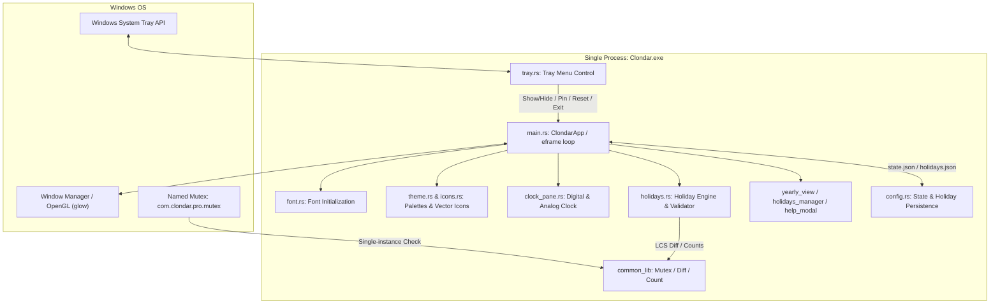

# Clondar Pro Architecture Design Document (Pure Rust / egui + glow Edition)

**English** | [日本語版](../ja/ARCHITECTURE.md)

This document details the system architecture, single-process design, native GUI rendering loop, state persistence, and shared library integrations (`common_lib`) of **Clondar Pro v2.0.0**.

> [!NOTE]
> The legacy Tauri v2 + WebView2 + React implementation (v1.4.4) is preserved on the `legacy/tauri-v1` branch. Starting with v2.0.0, Clondar Pro runs as a **100% Pure Rust native GUI application** without WebView2 or Node.js.

---

## 1. System Overview & Objectives

**Clondar Pro** is a resident desktop clock & calendar widget engineered exclusively for Windows.  
Designed around "wallpaper integration," it pairs a borderless, shadowless, transparent minimalist UI with low-footprint single-binary offline execution.

### Key Objectives & Value Proposition
- **Wallpaper Integration**: Eliminates OS window borders, chrome, and drop shadows so the clock and calendar sit directly on the desktop wallpaper.
- **Single-Process Native Footprint**: Powered by `egui` (`eframe 0.37.0`) on the **`glow` (OpenGL)** backend, eliminating WebView2 multi-process memory overhead.
- **Japanese Holiday Engine & Customization**: Calculates Japanese public holidays directly in Rust with external `holidays.json` customization, visual editing, LCS diff comparison, and reset support.
- **System Robustness**: Enforces single-instance execution via Windows Named Mutex, persists window coordinates and user preferences locally, and supports system tray residency.

---

## 2. Technology Stack

Version 2.0.0 removes the frontend/backend IPC boundary entirely by unifying all layers in Rust:

- **Rust (Edition 2021, rust-version 1.96.0)**: Provides compile-time memory safety, native performance, and direct OS integration.
- **eframe / egui (v0.37.0, `glow` + `default_fonts`)**: Immediate-mode Rust GUI framework. Selecting **`glow` (OpenGL only)** instead of the default `wgpu` backend avoids loading heavy D3D12/Vulkan/DXC shader compiler DLLs, slashing RAM usage.
- **chrono (v0.4.38)**: Local date/time retrieval and calendar arithmetic.
- **serde / serde_json (v1.0)**: Fast, strongly typed JSON serialization and validation for `state.json` and `holidays.json`.
- **tray-icon (v0.26.1)**: Windows system tray icon and right-click context menu management.
- **common_lib (Shared Crate)**: Supplies LCS diff computation (`compute_diff`), keyword frequency counting (`count_occurrences`), and Windows single-instance locking (`check_single_instance`).
- **winres (v0.1, build-dependencies)**: Embeds `icons/icon.ico` and Windows version/product metadata into `Clondar.exe` via `build.rs`.

---

## 3. Directory Structure & Layout

```text
clondar/ (Project Root)
├── .agents/                    # AI developer rules & verification skills
│   └── AGENTS.md               # Project development guidelines
├── .github/                    # GitHub Actions CI/CD workflows
│   ├── dependabot.yml          # Cargo & GitHub Actions dependency updates
│   └── workflows/
│       ├── ci.yml              # Pure Rust CI (fmt / clippy / test)
│       └── release.yml         # Windows Release build + NSIS packaging
├── config/
│   └── holidays.json           # Built-in default holiday rules (embedded via include_str!)
├── docs/                       # Technical documentation & guides
│   ├── assets/                 # Showcase screenshots
│   ├── ja/                     # Japanese documentation
│   └── en/                     # English documentation
├── icons/
│   └── icon.ico                # Application & installer icon
├── installer/
│   └── clondar.nsi             # NSIS installer script (JA/EN, HKCU local install)
├── scripts/
│   └── bump-version.ps1        # Batch version update PowerShell script
├── src/                        # Pure Rust application source code
│   ├── main.rs                 # Entrypoint, borderless window management, main loop
│   ├── clock_pane.rs           # Left pane UI (Digital & Analog clocks, mode toggles)
│   ├── holidays.rs             # Japanese holiday engine & schema validation
│   ├── holidays_manager.rs     # Holidays Manager modal (Visual / Raw JSON / Diff)
│   ├── yearly_view.rs          # 12-month yearly calendar overlay modal
│   ├── help_modal.rs           # Help & application info modal
│   ├── icons.rs                # Custom vector line icons (zero emoji/tofu glyphs)
│   ├── theme.rs                # Dark / Light / Transparent palettes & modal frame helpers
│   ├── tray.rs                 # System tray icon & context menu dispatcher
│   ├── font.rs                 # Windows system Japanese font loader (Yu Gothic UI, etc.)
│   └── config.rs               # Persistence I/O for state.json & holidays.json
├── build.rs                    # Windows icon & version resource embedder
└── Cargo.toml                  # Crate manifest (`Clondar` v2.0.0)
```

### Design Rationale
1. **Root-Level Rust Package**: Standard `cargo check`, `cargo test`, `cargo clippy`, and `cargo build --release` run directly at the repository root without nested frontend tooling.
2. **Modular Separation (`src/`)**: Keeps every source file compact and focused (preventing monolithic files over 1,000 lines) by separating clock rendering (`clock_pane.rs`), holiday engine (`holidays.rs`), modals, vector icons, and persistence.
3. **Single Source of Truth for Default Holidays**: Both `config.rs` (`DEFAULT_HOLIDAYS_JSON`) and `holidays.rs` unit tests embed `../config/holidays.json` via `include_str!`, eliminating duplicate holiday JSON definitions.

---

## 4. Process Model & Execution Lifecycle

Clondar Pro v2.0.0 runs as a **single OS process** with immediate-mode native GPU/OpenGL rendering:



### 4.1 Single-Instance Lock (Named Mutex)
- Immediately at startup, `main.rs` calls `common_lib::check_single_instance("com.clondar.pro.mutex", "Clondar")`.
- If another instance already holds the lock (`AlreadyRunning`), the duplicate process exits cleanly without interfering with the active widget.

### 4.2 Tray Residency & Throttled Repainting
- Pressing `Esc` (when no modal is open) or clicking the close icon hides the window to the system tray instead of exiting.
- Choosing "Exit" from the tray menu saves current state/coordinates and shuts down cleanly.
- Repaint cadence is tuned to active modes (e.g., smooth sweep updates in Analog mode or seconds-enabled Digital mode vs. low-frequency idle updates).

---

## 5. Persistence & Local Storage

All persistent files reside under `%LOCALAPPDATA%\com.clondar.pro\` with zero network calls:

| File Name       | Module      | Persisted Data                                                                                          |
| :-------------- | :---------- | :------------------------------------------------------------------------------------------------------ |
| `state.json`    | `config.rs` | `is_24_hour`, `show_seconds`, `clock_type`, `is_dark_mode`, `is_transparent`, `is_pinned`, `window_pos` |
| `holidays.json` | `config.rs` | Fixed holidays, Happy Mondays, Emperor birthdays, keyword rules, and special year overrides             |

> [!NOTE]
> If `holidays.json` is missing or unreadable, Clondar Pro falls back to `DEFAULT_HOLIDAYS_JSON` (compiled from `config/holidays.json`) and generates a clean local copy.

---

## 6. Shared Crate `common_lib` Resolution

`Cargo.toml` resolves `common_lib` via a sibling directory relative path for both local development and CI builds:

```toml
common_lib = { path = "../common_lib", features = ["windows_desktop"] }
```

- **Local Development**: Check out the `common_lib` repository alongside `clondar` (`../common_lib`).
- **GitHub Actions CI/CD**: Both `ci.yml` and `release.yml` check out `clondar` and `common_lib` side-by-side in the workspace so the relative path resolves identically in automated builds.
