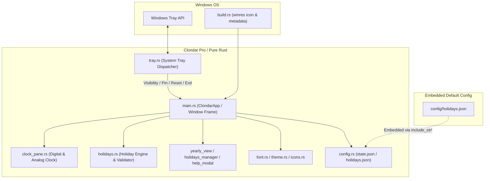

# Clondar Pro Developer Guide (Pure Rust / egui + glow Edition)

**English** | [日本語版](../ja/DEVELOPMENT.md)

This document explains the developer setup, source module organization, build commands, system tray integration, and holiday configuration mechanisms of **Clondar Pro v2.0.0**.

---

## 1. Architectural Overview

To provide a low-footprint, zero-external-dependency desktop widget, Clondar Pro v2.0.0 runs as a **100% Pure Rust native binary powered by egui (`eframe 0.37.0`) and the `glow` (OpenGL) backend**.



### Technology Highlights
* **eframe / egui + `glow` Backend**:
  Explicitly selecting the OpenGL-only `glow` feature instead of `eframe`'s default `wgpu` avoids loading bulky D3D12, Vulkan, and DXC shader compiler DLLs, cutting resident private memory dramatically.
* **Custom Vector Line Icons (`icons.rs`)**:
  Replaces OS-dependent emoji glyphs (which can degrade into tofu boxes) with crisp painter-drawn vector icons across the title bar and modals.
* **Zero External Runtime Dependencies**:
  Bundles `config/holidays.json` at compile time via `include_str!` while persisting user customizations locally under `%LOCALAPPDATA%\com.clondar.pro\`.

---

## 2. Directory Layout

```text
clondar/
├── Cargo.toml                  # Crate manifest & dependencies (`Clondar` v2.0.0)
├── build.rs                    # Windows icon & version metadata embedder (winres)
├── config/
│   └── holidays.json           # Built-in default holiday configuration
├── icons/
│   └── icon.ico                # Application & installer icon
├── installer/
│   └── clondar.nsi             # NSIS installer script (JA/EN, HKCU local install)
├── scripts/
│   └── bump-version.ps1        # Batch version bump PowerShell script
└── src/
    ├── main.rs                 # Entrypoint, window frame, tray bridge, calendar pane
    ├── clock_pane.rs           # Digital & Analog clock and control chip rendering
    ├── holidays.rs             # Japanese holiday calculation engine & JSON validator
    ├── holidays_manager.rs     # Holidays Manager modal (Edit / Raw JSON / Diff / Stats)
    ├── yearly_view.rs          # 12-month yearly calendar overlay modal
    ├── help_modal.rs           # Help & application info modal
    ├── icons.rs                # Vector icon primitives
    ├── theme.rs                # Dark / Light / Transparent palettes & modal overlays
    ├── tray.rs                 # tray-icon wrapper & context menu actions
    ├── font.rs                 # Windows Japanese font loader (Yu Gothic UI, etc.)
    └── config.rs               # state.json & holidays.json persistence
```

---

## 3. Setup, Verification & Build Commands

Building and running Clondar Pro v2.0.0 requires **Rust (1.96.0+ recommended, MSVC target)** and **NSIS (`makensis`)** (only when creating the Windows setup executable). Node.js is no longer required.

### Resolving `common_lib`
`Cargo.toml` references the shared utility crate `common_lib` using a relative sibling path:
```toml
common_lib = { path = "../common_lib", features = ["windows_desktop"] }
```

Ensure `common_lib` is checked out in the sibling directory (`../common_lib`) alongside `clondar`.

### 1. Run in Development Mode
```bash
cargo run
```

### 2. Run Pre-Verification Checks
```bash
cargo fmt --check
cargo clippy --all-targets -- -D warnings
cargo test
```

### 3. Production Release Build & NSIS Installer
```powershell
cargo build --release
# Output binary: target\release\Clondar.exe

# Build NSIS installer
makensis installer\clondar.nsi
# Output installer: installer\Clondar_Pro_2.0.0_x64-setup.exe
```

---

## 4. Technical Highlights

### ① System Tray Residency & Single Instance Guard
[tray.rs](../../src/tray.rs) and [main.rs](../../src/main.rs) manage the Windows system tray icon (`tray-icon`), allowing users to minimize/hide the widget instead of terminating it. At boot, `common_lib::check_single_instance("com.clondar.pro.mutex", "Clondar")` blocks duplicate instances cleanly.

### ② Single-Source Holiday Rules (`holidays.json`)
User-customized holiday settings are saved under `%LOCALAPPDATA%\com.clondar.pro\holidays.json`. Built-in defaults reside in a single canonical file, [config/holidays.json](../../config/holidays.json), shared via `include_str!` between [config.rs](../../src/config.rs) and unit tests in [holidays.rs](../../src/holidays.rs).

---

## 5. Coding & Documentation Standards

* **RustDoc Comments**: Document modules (`//!`), public structs, and functions (`///`) clearly.
* **Japanese Inline Comments**: Project inline comments and docstrings are maintained in **Japanese** (`AGENTS.md`).
* **Modular File Size Target**: Proactively split any source file before it exceeds 1,000 lines.
