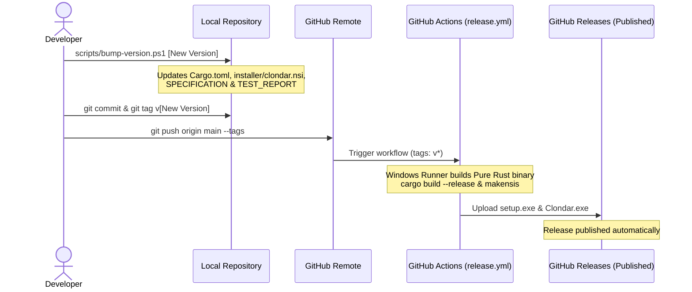

# Clondar Pro Release Procedure (GitHub Actions Automation)

**English** | [日本語版](../ja/RELEASE.md)

This document explains how to bump versions, build the Pure Rust binary and NSIS installer, and manage automated releases via GitHub Actions for **Clondar Pro v2.0.0**.

---

## 1. Release Pipeline Overview

Releases are driven by **GitHub Actions Pure Rust + NSIS automation**, triggered whenever a semantic version tag (`v*`) is pushed.



---

## 2. Preparing Releases Locally

Before creating a release tag, run the PowerShell bump script to synchronize versions across the crate manifest, NSIS script, and documentation.

### 2.1 Running the Batch Version Update Script

```powershell
# Temporarily bypass script execution policy (e.g., setting version 2.0.0)
powershell -ExecutionPolicy Bypass -File .\scripts\bump-version.ps1 2.0.0
```

- **Script Behavior**:
  - Updates `version = "..."` inside root `Cargo.toml`.
  - Updates `!define PRODUCT_VERSION "..."` inside `installer/clondar.nsi`.
  - Updates version fields in `docs/ja/SPECIFICATION.md` and `docs/en/SPECIFICATION.md`.
  - Updates target version fields in `docs/ja/TEST_REPORT.md` and `docs/en/TEST_REPORT.md`.

---

## 3. Creating & Pushing Version Tags

Commit the updated files, tag the commit, and push both the branch and tag to GitHub:

```bash
# 1. Stage and commit changes
git add .
git commit -m "chore: release version 2.0.0"

# 2. Tag target commit
git tag v2.0.0

# 3. Push commit and tag to remote origin
git push origin main
git push origin v2.0.0
```

---

## 4. Automated Build & Release Publication via GitHub Actions

Pushing a `v*` tag triggers `.github/workflows/release.yml`.

### 4.1 Workflow Steps
1. **Checkout & Rust Toolchain**: Checks out `clondar` and `common_lib` side-by-side and configures Rust (`x86_64-pc-windows-msvc`).
2. **Release Compilation (`cargo build --release`)**: Compiles `Clondar.exe` with size optimization, LTO, symbol stripping, and `build.rs` icon/version embedding.
3. **NSIS Packaging**: Runs `makensis installer/clondar.nsi` (installing NSIS via Chocolatey if not already present) to build `installer/Clondar_Pro_<version>_x64-setup.exe`.
4. **Release Publication**: Uses `softprops/action-gh-release` to publish the release (`draft: false`) and attach the deliverables.

### 4.2 Released Assets
- `clondar/installer/Clondar_Pro_<version>_x64-setup.exe` (Bilingual JA/EN NSIS Installer)
- `clondar/target/release/Clondar.exe` (Standalone portable binary)

---

## 5. Verifying Releases

1. Open "**Releases**" in the GitHub repository.
2. Confirm the release for the target tag exists with both the NSIS installer and `Clondar.exe` attached.
