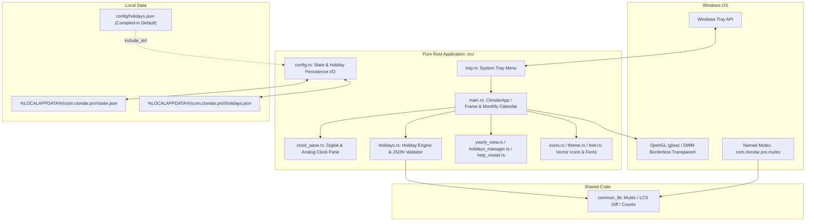

# Clondar Pro Product Specification (Pure Rust / egui + glow Edition)

**English** | [日本語版](../ja/SPECIFICATION.md)

## 1. Product Overview
**Clondar Pro** is a Pure Rust (`eframe 0.37.0` / `egui` + `glow`) desktop clock & calendar widget designed exclusively for Windows.  
Embodying "wallpaper integration," it eliminates standard window borders and drop shadows over transparent backgrounds while delivering single-process, WebView2-free lightweight execution.

---

## 2. System Architecture Diagram (Mermaid)

---

## 3. Core Features Detail

### 3.1 Desktop Widget Behavior
* **Window Transparency**: Renders typography and calendar cells transparently directly onto the wallpaper when transparency mode is enabled.
* **Borderless & Shadowless**: Removes OS window chrome, title bars, and drop shadows.
* **Always on Top (Pin)**: Keeps the widget pinned above other open application windows.
* **Drag-to-Move**: Drag anywhere on the title bar or background area to reposition freely.
* **Hide to Tray**: Pressing `Esc` (dismissing any open modal first) or clicking close minimizes/hides the widget into the system tray.
* **System Tray Context Menu**: Supports Show/Hide, Toggle Always on Top, Reset Position, and clean Exit.

### 3.2 Clock Pane (`clock_pane.rs`)
* **Mode Switcher**: Centered `DIGITAL` / `ANALOG` pill tabs.
* **Digital Clock**: High-contrast bold tabular digits without layout shift during updates, plus 12H/24H (AM/PM) and seconds visibility toggles.
* **Analog Clock**: Enlarged circular dial with smooth sweep second-hand rotation (automatically disables the `24H` control button while Analog mode is active).
* **Locked Bottom Control Row**: Bottom control chips (`24H`, seconds toggle, theme toggle) stay vertically aligned across mode and 12H/24H transitions.

### 3.3 Calendar & Holiday Features (`main.rs`, `yearly_view.rs`, `holidays_manager.rs`, `holidays.rs`)
* **Fixed 6-Week Grid**: Always renders 42 day cells so widget height never jumps between months.
* **Japanese Holiday Engine (`holidays.rs`)**: Evaluates fixed dates, Happy Mondays, Vernal/Autumnal Equinoxes, Emperors' Birthdays, substitute holidays, bridge national holidays, and year overrides natively in Rust.
* **Yearly Overlay (`yearly_view.rs`)**: Full-canvas 12-month view with previous/next year controls.
* **Holidays Manager (`holidays_manager.rs`)**: Integrates with `common_lib` to provide visual fixed-holiday editing, Raw JSON editing, LCS diff visualization, keyword occurrence metrics, Reset to built-in defaults, and Save/Apply to `%LOCALAPPDATA%\com.clondar.pro\holidays.json` with strict Serde date/week bounds validation.

### 3.4 State Persistence (`config.rs`)
* Persists `is_24_hour`, `show_seconds`, `clock_type`, `is_dark_mode`, `is_transparent`, `is_pinned`, and `window_pos` locally inside `%LOCALAPPDATA%\com.clondar.pro\state.json`.

### 3.5 Help & App Info (`help_modal.rs`)
* Opened via the title bar `?` icon, presenting dynamic versioning (`CARGO_PKG_VERSION`), architecture overview, and six uniform-height feature cards.

---

## 4. Visual & Build Specifications

* **Custom Vector Line Icons (`icons.rs`)**: Prevents OS emoji font fallbacks and tofu glyphs.
* **System Japanese Typography (`font.rs`)**: Loads Windows Yu Gothic UI fonts with tuned alignment.
* **Release Profile (`Cargo.toml`)**: Applies `opt-level = 'z'`, `lto = true`, `codegen-units = 1`, `panic = 'abort'`, and `strip = true`.
* **Packaging (`build.rs` & `installer/clondar.nsi`)**: Embeds `icons/icon.ico` and version metadata via `winres` into `Clondar.exe` and compiles a bilingual Japanese/English NSIS installer targeting `%LOCALAPPDATA%\Clondar Pro\`.

---

**Last Updated**: November 16, 2026  
**Version**: 2.0.0
**Internal Version**: 2.0.0.0
