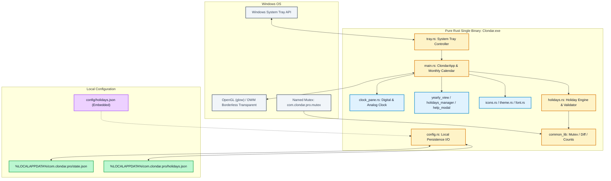

# Self-Test Report & System Architecture Diagram

**English** | [日本語版](../ja/TEST_REPORT.md)

## 1. Self-Test Report

### Testing Environment
- **OS**: Windows 11 (64-bit)
- **Toolchain**: Pure Rust (`rust-version = "1.96.0"`), `eframe 0.37.0` (`egui` + `glow`), NSIS (`makensis`)
- **Configuration**: Single-process native GUI, borderless, shadowless, transparent background, system tray residency, Named Mutex lock

### Verification Matrix & Results (v2.0.0)

| Test ID | Verification Target             | Expected Behavior                                                                            | Verification Result                                                                                                                 | Status   |
| :------ | :------------------------------ | :------------------------------------------------------------------------------------------- | :---------------------------------------------------------------------------------------------------------------------------------- | :------- |
| TS-001  | Pure Rust Holiday Engine        | Accurately computes fixed, Happy Monday, equinox, imperial, substitute, and special holidays | All calculation unit tests in `holidays::tests` pass cleanly                                                                        | **PASS** |
| TS-002  | Default Config & Schema Bounds  | Embedded `config/holidays.json` parses cleanly; out-of-range dates/weeks are rejected        | `test_default_holidays_json_validity`, `test_validation_error_handling`, and `holidays_manager::tests` pass                         | **PASS** |
| TS-003  | `common_lib` Integration        | LCS text diff (`compute_diff`) and keyword occurrence counts work accurately                 | All 12 `cargo test` cases (including `test_holidays_diff_logic` and `test_word_count_logic`) pass 100%                              | **PASS** |
| TS-004  | Formatting & Clippy Static Lint | Strict Rustfmt compliance and zero Clippy warnings                                           | `cargo fmt --check` and `cargo clippy --all-targets -- -D warnings` exit with code 0                                                | **PASS** |
| TS-005  | Rustdoc Build Verification      | Full documentation compiles cleanly including private items                                  | `cargo doc --no-deps --document-private-items` succeeds with exit code 0                                                            | **PASS** |
| TS-006  | Release Executable Build        | Compiles `Clondar.exe` with embedded Windows icon & metadata via `winres`                    | `cargo build --release` completes cleanly, producing `target/release/Clondar.exe` (**4.89 MB**)                                     | **PASS** |
| TS-007  | NSIS Bilingual Installer Build  | Compiles JA/EN NSIS installer script with zero errors and zero warnings                      | `makensis installer\clondar.nsi` (UTF-8 BOM) succeeds with 0 warnings: `Clondar_Pro_2.0.0_x64-setup.exe` (**2.59 MB**)              | **PASS** |
| TS-008  | `glow` Memory Reduction Check   | Switching from `wgpu` to `glow` achieves low single-process private memory                   | Simultaneous Windows measurement on 2026-11-16 recorded 1 process / **68.45 MB** Private (vs. 190.74 MB Phase B / 293.06 MB `wgpu`) | **PASS** |

> *(Historical Tauri v2 / WebView2 test records TS-001..TS-034 are preserved on the `legacy/tauri-v1` branch.)*

---

## 2. System Architecture Diagram

---
**Created**: July 10, 2026  
**Last Updated**: November 16, 2026  
**Target Version**: Widget v2.0.0 (Pure Rust Native GUI with egui + glow)
