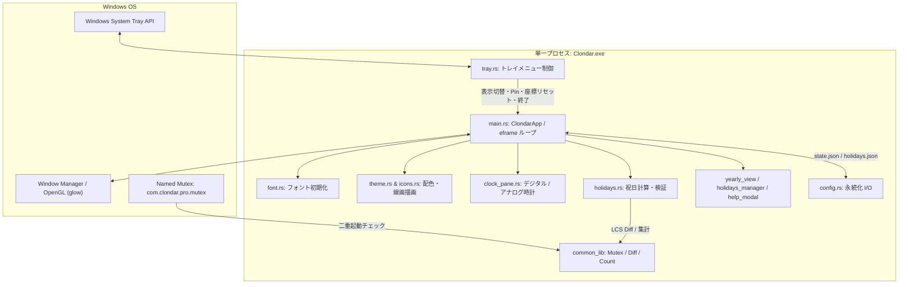

# Clondar Pro アーキテクチャ設計書 (Pure Rust / egui + glow 版)

[English Version](../en/ARCHITECTURE.md) | **日本語版**

このドキュメントでは、**Clondar Pro v2.0.0** のシステム構成、単一プロセス設計、UI 描画ループ、状態管理、および共有ライブラリ（`common_lib`）との連携に関する技術的な詳細を記述します。

> [!NOTE]
> 旧 Tauri v2 + WebView2 + React 構成（v1.4.4）は、履歴保全のため `legacy/tauri-v1` ブランチに退避されています。v2.0.0 以降は WebView2・Node.js を完全に廃した **Pure Rust ネイティブ GUI 構成** です。

---

## 1. システム概要・目的

**Clondar Pro** は、Windows デスクトップ専用の常駐型「時計・カレンダーウィジェット」アプリケーションです。  
「壁紙一体化」をコンセプトとし、枠なし・影なし・背景透過によるミニマルなデザインと、単一ネイティブバイナリによる低メモリ・完全オフライン動作を両立しています。

### 主な目的と特徴
- **壁紙に溶け込むデザイン**: ウィンドウのタイトルバーや枠線、OS 標準のドロップシャドウを排除し、デスクトップ上に直接時刻とカレンダーを描画します。
- **単一プロセス・軽量常駐**: `egui` (`eframe 0.37.0`) + **`glow` (OpenGL)** バックエンドにより、WebView2 サブプロセス群を持たない単一プロセスで軽量動作します。
- **日本の祝日計算エンジンとカスタマイズ**: 外部 JSON 設定（`holidays.json`）に対応し、アプリ内蔵の祝日設定マネージャーから GUI 編集・差分比較・初期化を行えます。
- **システム整合性**: 多重起動防止（Named Mutex）、高 DPI 環境下のウィンドウ位置復元、システムトレイ常駐、安全な終了処理を備えています。

---

## 2. 技術スタック

v2.0.0 ではフロントエンド（Node.js / React）とバックエンドの境界をなくし、全レイヤーを Rust で統一しています。

- **Rust (Edition 2021, rust-version 1.96.0)**: アプリケーション全体を構成するシステムプログラミング言語。メモリ安全性とネイティブ実行速度を保証します。
- **eframe / egui (v0.37.0, `glow` + `default_fonts`)**: 即時モード（Immediate Mode）GUI フレームワーク。重いシェーダコンパイラ群を伴う `wgpu` を無効化し、OpenGL 単体の **`glow`** バックエンドを選択することで大幅なメモリ削減を実現しています。
- **chrono (v0.4.38)**: 現在時刻取得・ローカルタイムゾーン・暦日計算ライブラリ。
- **serde / serde_json (v1.0)**: `state.json` および `holidays.json` の高速かつ型安全な読み書き・シリアライズを担当します。
- **tray-icon (v0.26.1)**: Windows システムトレイアイコンおよびコンテキストメニュー制御を担当します。
- **common_lib (共有クレート)**: LCS テキスト差分計算（`compute_diff`）、ワード出現回数集計（`count_occurrences`）、Windows 多重起動防止ロック（`check_single_instance`）を提供する共通ライブラリです。
- **winres (v0.1, build-dependencies)**: `build.rs` 経由で `icons/icon.ico` と Windows 製品バージョンメタデータを `Clondar.exe` へ埋め込みます。

---

## 3. ディレクトリ構成と設計意図

```text
clondar/ (プロジェクトルート)
├── .agents/                    # AI開発者向けルール・スキル定義
│   └── AGENTS.md               # コーディング・検証ガイドライン
├── .github/                    # CI/CD 自動化設定 (GitHub Actions)
│   ├── dependabot.yml          # Cargo / GitHub Actions 依存関係自動更新
│   └── workflows/
│       ├── ci.yml              # Pure Rust CI (fmt / clippy / test)
│       └── release.yml         # Windows Release ビルド + NSIS 生成
├── config/
│   └── holidays.json           # 標準祝日定義 (バイナリに include_str! で内蔵)
├── docs/                       # 設計書・仕様書・運用ガイド類
│   ├── assets/                 # README 用スクリーンショット画像
│   ├── ja/                     # 日本語ドキュメント一式
│   └── en/                     # 英語ドキュメント一式
├── icons/
│   └── icon.ico                # Windows アプリケーション / インストーラーアイコン
├── installer/
│   └── clondar.nsi             # NSIS インストーラースクリプト (日英対応・HKCU 導入)
├── scripts/
│   └── bump-version.ps1        # 一括バージョン更新スクリプト
├── src/                        # Pure Rust アプリケーションソースコード
│   ├── main.rs                 # エントリポイント、ウィンドウ枠制御、メインループ
│   ├── clock_pane.rs           # 左ペイン UI (デジタル / アナログ時計・切替操作)
│   ├── holidays.rs             # 日本の祝日計算エンジン・JSON スキーマ検証
│   ├── holidays_manager.rs     # 祝日設定マネージャーモーダル (編集 / 生データ / Diff)
│   ├── yearly_view.rs          # 年間カレンダーオーバーレイモーダル (12ヶ月表示)
│   ├── help_modal.rs           # ヘルプ＆アプリ情報モーダル
│   ├── icons.rs                # 豆腐文字化けを防ぐカスタムベクター線画アイコン群
│   ├── theme.rs                # ダーク / ライト / 背景透過パレット・モーダル枠描画
│   ├── tray.rs                 # システムトレイアイコン・右クリックメニューイベント処理
│   ├── font.rs                 # Windows 日本語フォント (游ゴシック UI 等) 読み込み
│   └── config.rs               # ユーザー設定・ウィンドウ座標・holidays.json 永続化
├── build.rs                    # Windows アイコン・バージョンリソース埋め込みスクリプト
└── Cargo.toml                  # 依存関係・パッケージ定義 (`Clondar` v2.0.0)
```

### ディレクトリ構成の設計意図
1. **リポジトリ直下への Rust パッケージ統合**: `cargo check` / `cargo test` / `cargo build --release` をルート直下で即座に実行でき、ビルド構成がシンプルです。
2. **機能別モジュール分割 (`src/`)**: 1ファイルが肥大化（1000行超）しないよう、時計ペイン（`clock_pane.rs`）、祝日計算（`holidays.rs`）、各モーダル、ベクターアイコン、設定永続化を明確に分離しています。
3. **単一ソース（Single Source of Truth）による祝日定義**: `config/holidays.json` を `include_str!("../config/holidays.json")` 経由で `config.rs` と `holidays.rs` テストの双方から参照し、重複定義を排除しています。

---

## 4. プロセスモデルと実行ライフサイクル

v2.0.0 は WebView2 サブプロセスを一切生成しない **単一プロセス・即時モード描画モデル** です。



### 4.1 二重起動の防止 (Named Mutex)
- 起動直後に `common_lib::check_single_instance("com.clondar.pro.mutex", "Clondar")` を呼び出し、OS レベルの名前付きミューテックスを取得します。
- すでに別プロセスがロックを保持している場合（`AlreadyRunning`）は二重起動を行わず即座に安全終了します。

### 4.2 トレイ常駐と省電力再描画ループ
- `Esc` キーまたはタイトルバーの閉じるボタン押下時はプロセスを終了せず、ウィンドウを非表示にしてシステムトレイへ格納します。
- 完全終了はトレイメニューの「終了」から実行し、終了時に現在の表示設定およびウィンドウ座標を保存します。
- 再描画間隔は、アナログ時計表示時や秒表示 ON 時などの表示要件に応じて最適化し、待機時 CPU 負荷を抑えています。

---

## 5. 永続化ストレージ仕様

すべての設定データは `%LOCALAPPDATA%\com.clondar.pro\` 配下にローカル JSON ファイルとして保存され、外部サーバー通信は一切行いません。

| ファイル名      | 担当モジュール | 主な保存データ                                                                                          |
| :-------------- | :------------- | :------------------------------------------------------------------------------------------------------ |
| `state.json`    | `config.rs`    | `is_24_hour`, `show_seconds`, `clock_type`, `is_dark_mode`, `is_transparent`, `is_pinned`, `window_pos` |
| `holidays.json` | `config.rs`    | 固定祝日・ハッピーマンデー・天皇誕生日・振替/国民の休日キーワード・年別特例定義                         |

> [!NOTE]
> `holidays.json` が存在しない、または構文破損している場合は、バイナリ内蔵の `DEFAULT_HOLIDAYS_JSON`（`config/holidays.json`）から自動生成・フォールバックします。

---

## 6. 共有クレート `common_lib` の解決

`Cargo.toml` では開発時の即応性と CI 再現性を両立するため、兄弟ディレクトリへの相対パスで `common_lib` を参照しています。

```toml
common_lib = { path = "../common_lib", features = ["windows_desktop"] }
```

- **ローカル開発時**: `clondar/` と同階層（`../common_lib`）に `common_lib` リポジトリを配置します。
- **GitHub Actions CI/CD**: `ci.yml` および `release.yml` が `clondar/` と並列に `common_lib/` を自動チェックアウトするため、同一の相対パス解決がそのまま動作します。
