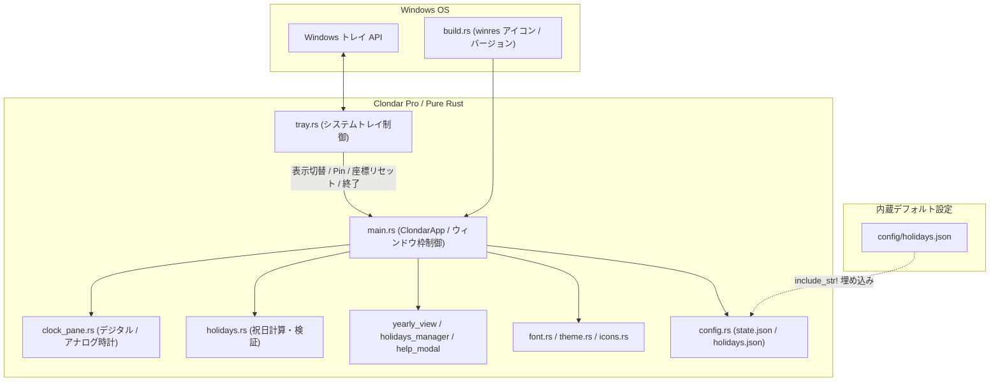

# Clondar Pro 開発者ガイド (Pure Rust / egui + glow 版)

[English Version](../en/DEVELOPMENT.md) | **日本語版**

本ドキュメントは、**Clondar Pro v2.0.0** の開発環境構築、ソースコード構成、システムトレイや外部祝日設定ファイルの仕組みを解説する開発者向けガイドラインです。

---

## 1. アーキテクチャ概要

PC が完全にオフラインの状態でも軽快に動作するデスクトップウィジェットを実現するため、v2.0.0 では **Rust + egui (`eframe 0.37.0`) + `glow` (OpenGL)** による完全オフライン・単一ネイティブバイナリ構成を採用しています。



### 採用技術の特徴
* **eframe / egui + `glow` バックエンド**:
  デフォルトの `wgpu` ではなく OpenGL 単体の `glow` フィーチャを選択することで、GPU シェーダコンパイラや DX12/Vulkan ドライバ DLL の過剰なロードを防ぎ、メモリ消費を大幅に削減しています。
* **カスタムベクター線画アイコン (`icons.rs`)**:
  OS 環境依存の絵文字フォールバックによる豆腐文字化けを防ぐため、タイトルバーやモーダル内のアイコンをすべて座標ベースの線画・ベクター描画で実装しています。
* **外部依存ゼロ（完全オフライン）**:
  `config/holidays.json` を `include_str!` でバイナリに内蔵しつつ、ユーザー環境ごとのカスタマイズを `%LOCALAPPDATA%\com.clondar.pro\` へ保存します。

---

## 2. ディレクトリ構成

リポジトリ直下に Rust プロジェクトと全設定を配置しています：

```text
clondar/
├── Cargo.toml                  # プロジェクト定義・依存関係 (`Clondar` v2.0.0)
├── build.rs                    # Windows アイコン・メタデータ埋め込み (winres)
├── config/
│   └── holidays.json           # デフォルト祝日設定 (内蔵テンプレート)
├── icons/
│   └── icon.ico                # アプリケーション / インストーラーアイコン
├── installer/
│   └── clondar.nsi             # NSIS インストーラー定義スクリプト
├── scripts/
│   └── bump-version.ps1        # 一括バージョン更新スクリプト
└── src/
    ├── main.rs                 # アプリ本体、ウィンドウ属性・トレイ連携・カレンダー描画
    ├── clock_pane.rs           # デジタル / アナログ時計および下部ボタン制御
    ├── holidays.rs             # 日本の祝日計算エンジン・JSON スキーマ検証
    ├── holidays_manager.rs     # 祝日設定マネージャー (UI 編集 / 生データ / Diff / 集計)
    ├── yearly_view.rs          # 12ヶ月年間カレンダーモーダル
    ├── help_modal.rs           # ヘルプ＆アプリ情報モーダル
    ├── icons.rs                # カスタムベクターアイコン描画
    ├── theme.rs                # ライト / ダーク / 背景透過パレット・モーダル外枠
    ├── tray.rs                 # tray-icon ラッパー・メニュー生成
    ├── font.rs                 # Windows 日本語フォント読み込み (游ゴシック UI 等)
    └── config.rs               # state.json / holidays.json 読み書き永続化
```

---

## 3. 環境構築とビルド・実行方法

開発およびビルドには **Rust (1.96.0 以上推奨, MSVC ツールチェーン)** と **NSIS (`makensis`)**（インストーラー生成時のみ）が必要です。Node.js は不要です。

### 共有クレート `common_lib` の解決
本プロジェクトは共通ライブラリ `common_lib` をローカル相対パスで参照しています（`Cargo.toml`）：
```toml
common_lib = { path = "../common_lib", features = ["windows_desktop"] }
```

開発時は、`clondar` フォルダと **同じ親ディレクトリ配下**（`../common_lib`）に `common_lib` リポジトリを配置してください。

### 1. 開発ビルド・起動
リポジトリ直下で以下を実行します：
```bash
cargo run
```

### 2. 事前検証（チェック・テスト・静的解析）
```bash
cargo fmt --check
cargo clippy --all-targets -- -D warnings
cargo test
```

### 3. 本番リリースビルド & NSIS インストーラー作成
```powershell
cargo build --release
# 出力先: target\release\Clondar.exe

# NSIS インストーラー生成（例: Windows 環境）
makensis installer\clondar.nsi
# 出力先: installer\Clondar_Pro_2.0.0_x64-setup.exe
```

---

## 4. 技術的なポイント

### ① システムトレイ常駐と二重起動防止
[tray.rs](../../src/tray.rs) と [main.rs](../../src/main.rs) で `tray-icon` を制御し、ウィンドウを閉じてもトレイに常駐します。
また起動時には `common_lib::check_single_instance("com.clondar.pro.mutex", "Clondar")` によって多重起動を防止します。

### ② 外部祝日設定ファイル (`holidays.json`) と単一ソース管理
日本の祝日ルールは `%LOCALAPPDATA%\com.clondar.pro\holidays.json` に保存されます。
既定設定は [config/holidays.json](../../config/holidays.json) 1箇所で管理されており、[config.rs](../../src/config.rs) と [holidays.rs](../../src/holidays.rs) のテスト双方から `include_str!` で共有しています。

---

## 5. ドキュメントコメントと開発規約

コードの可読性と保守性を高めるため、以下のルールを徹底しています。

* **RustDoc コメント**: 公開構造体・モジュール・主要関数には `//!` / `///` で役割や引数を記述します。
* **日本語コメント**: モジュール解説および非自明なロジックのコメント（「なぜそうするか」）は**日本語**で記述します。
* **モジュール分割の目安**: 単一ファイルが 1000行を超える前に責務単位で分割します。
