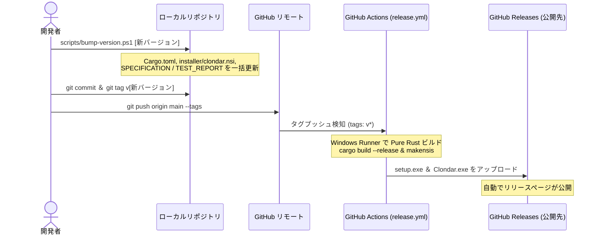

# Clondar Pro リリース手順書 (GitHub Actions 自動化対応)

[English Version](../en/RELEASE.md) | **日本語版**

このドキュメントは、**Clondar Pro v2.0.0** のバージョン番号更新から本番用ビルド・NSIS インストーラー生成・GitHub Releases 公開までの一連のリリース手順を解説するガイドラインです。

---

## 1. リリースパイプライン全体像

Clondar Pro のリリース作業は、バージョンタグ（`v*`）の Push をトリガーとした **GitHub Actions による Pure Rust + NSIS 自動ビルドワークフロー** で運用されています。



---

## 2. リリース準備作業（ローカル）

リリースを作成する場合、事前に各ファイル（`Cargo.toml`、`installer/clondar.nsi`、仕様書等）のバージョン番号を一括更新します。

### 2.1 バージョン一括更新スクリプトの実行

PowerShell を開き、リポジトリルートで以下のスクリプトを実行します。

```powershell
# 実行ポリシーを一時的にバイパスしてスクリプト実行（例: バージョン 2.0.0 へ更新）
powershell -ExecutionPolicy Bypass -File .\scripts\bump-version.ps1 2.0.0
```

- **スクリプトの動作内容**:
  - ルート `Cargo.toml` の `version = "..."` を更新します。
  - `installer/clondar.nsi` の `!define PRODUCT_VERSION "..."` を更新します。
  - `docs/ja/SPECIFICATION.md` および `docs/en/SPECIFICATION.md` のバージョン表記を更新します。
  - `docs/ja/TEST_REPORT.md` および `docs/en/TEST_REPORT.md` の対象バージョンを更新します。

> [!NOTE]
> スクリプト実行後は `CHANGELOG.md`（日英）や `FOOTPRINTS.md` に必要な更新履歴を追記し、`cargo test` 等で事前検証を完了させてください。

---

## 3. リリースタグの作成とプッシュ

ファイルの更新内容を確認してコミットし、バージョンタグを作成して GitHub へプッシュします。

```bash
# 1. 変更をステージング・コミット
git add .
git commit -m "chore: バージョン 2.0.0 をリリース"

# 2. タグを付与（セマンティックバージョニングに従い、先頭に v を付ける）
git tag v2.0.0

# 3. コミットとタグをリモートへプッシュ
git push origin main
git push origin v2.0.0
```

---

## 4. GitHub Actions による自動ビルドと公開

タグをプッシュすると、`.github/workflows/release.yml` が自動的に起動します。

### 4.1 ワークフローの処理内容
1. **チェックアウト ＆ Rust 環境構築**: `clondar` と並列に共有クレート `common_lib` をチェックアウトし、Rust ツールチェーン（MSVC ターゲット）をセットアップします。
2. **ネイティブビルド (`cargo build --release`)**: LTO・サイズ最適化・シンボルストリップを有効化して `Clondar.exe` をビルドします（`build.rs` によりアイコン・バージョン情報も埋め込み）。
3. **NSIS インストーラー生成**: Windows ランナー上の `makensis`（未導入時は Chocolatey 経由で取得）で `installer/clondar.nsi` をコンパイルし、`installer/Clondar_Pro_<version>_x64-setup.exe` を生成します。
4. **GitHub Releases への公開**: `softprops/action-gh-release` を使用し、成果物を添付してリリースページを公開します（`draft: false`）。

### 4.2 公開される成果物
リリース完了後、以下の実行ファイルおよびインストーラーが自動で添付されます：
- `clondar/installer/Clondar_Pro_<version>_x64-setup.exe`（NSIS 日英対応インストーラー）
- `clondar/target/release/Clondar.exe`（ポータブル実行バイナリ）

---

## 5. リリース後の確認

1. GitHub リポジトリ画面の「**Releases**」ページを開きます。
2. 対象バージョンのリリースが作成され、NSIS インストーラーおよび `Clondar.exe` が添付されていることを確認します。
