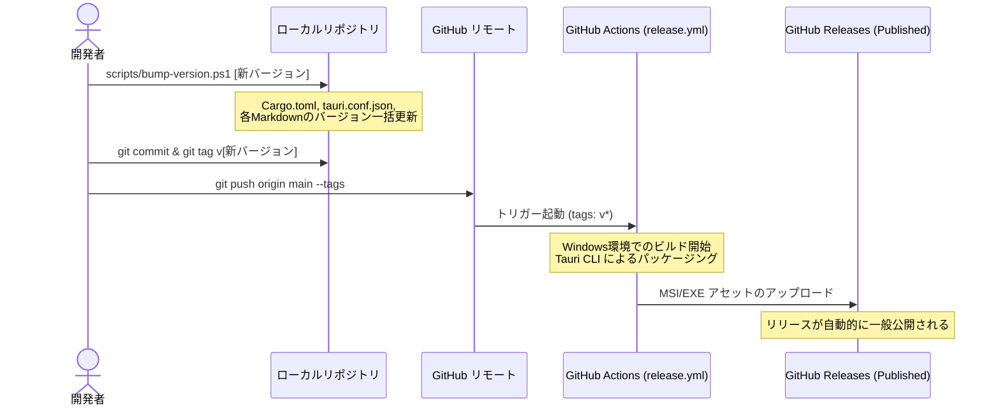

# Clondar Pro リリース手順書 (GitHub Actions Automation)

[English Version](../en/RELEASE.md) | **日本語版**

本ドキュメントは、Clondar Pro のバージョン更新方法、リリースビルドの実行手順、および GitHub Actions による自動リリースフローについて解説するガイドラインです。

---

## 1. リリースフローの概要

Clondar Pro のリリースは、ローカル環境でのバージョンバンプと Git バージョンタグ（`v*`）のプッシュをトリガーとした **GitHub Actions による自動ビルド・デプロイ構成**となっています。



---

## 2. ローカルでのリリース準備

リリースを行う前に、プロジェクト内のすべてのバージョン表記（`Cargo.toml`、`tauri.conf.json`、各種Markdownドキュメント）を統一して更新する必要があります。この作業を自動化するために PowerShell スクリプトが用意されています。

### 2.1 バージョン一括更新スクリプトの実行

PowerShell を起動し、リポジトリのルートディレクトリで以下のスクリプトを実行します。

```powershell
# 実行ポリシーを一時的に緩和してスクリプトを実行 (例: バージョン 1.4.1 へ更新する場合)
powershell -ExecutionPolicy Bypass -File .\scripts\bump-version.ps1 1.4.1
```

- **スクリプトの動作**:
  - `src-tauri/Cargo.toml` の `version = "..."` を更新。
  - `src-tauri/tauri.conf.json` および `package.json` の `version` を更新。
  - `docs/ja/SPECIFICATION.md` および `docs/en/SPECIFICATION.md` 内のバージョン表記（および内部バージョン表記）を更新。
  - `docs/ja/TEST_REPORT.md` および `docs/en/TEST_REPORT.md` 内の適合バージョン表記を更新。

---

## 3. バージョンタグの作成とプッシュ

バージョンの更新スクリプトの実行が完了したら、コミットを行い、リリース対象のバージョンタグを作成して GitHub にプッシュします。

```bash
# 1. 変更内容をステージングしてコミット
git add .
git commit -m "chore: バージョン 1.4.1 への更新"

# 2. バージョンタグを作成 (セマンティックバージョニングに準拠し、頭に v を付けます)
git tag v1.4.1

# 3. コミットと作成したタグをリモートにプッシュ
git push origin main
git push origin v1.4.1
```

---

## 4. GitHub Actions での自動ビルドとリリース公開

タグのプッシュを GitHub が検知すると、`.github/workflows/release.yml` が自動的に起動します。

### 4.1 ワークフローの実行内容
1. **環境セットアップ**: Node.js および Rust (MSVC ターゲット) 環境をランナー上に構築し、`clondar` および共有クレート `common_lib` をチェックアウトします。
2. **フロントエンドビルド**: プロジェクトルートで `npm ci` を実行し、依存関係をセットアップします。
3. **Tauri アプリのビルド**: `tauri build` を実行し、Windows 向けの最終アセットをコンパイル・パッケージングします。
4. **リリース作成とアップロード**: `softprops/action-gh-release@v3` を用いて、GitHub 上にリリースを自動作成・公開（`draft: false`）し、ビルドされたアセットファイルを添付します。

### 4.2 生成されるリリースアセット
ビルド成功時、以下のパスに出力されたアセットが GitHub Releases にアップロードされます。
- `clondar/src-tauri/target/release/bundle/nsis/*.exe` （NSIS サイレントインストーラー）
- `clondar/src-tauri/target/release/bundle/wix/*.msi` （WiX インストーラーパッケージ）

---

## 5. リリースの確認

1. リポジトリの GitHub ページを開き、「**Releases**」にアクセスします。
2. `v1.4.1` のリリースが公開され、MSI / EXE インストーラーアセットが正常に添付されていることを確認します。
