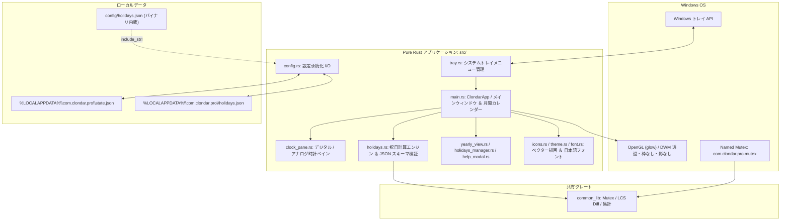

# Clondar Pro 製品仕様書 (Pure Rust / egui + glow 版)

[English Version](../en/SPECIFICATION.md) | **日本語版**

## 1. 製品概要
**Clondar Pro** は、Pure Rust (`eframe 0.37.0` / `egui` + `glow`) で構築された Windows 専用の常駐型時計・カレンダーウィジェットアプリケーションです。  
「壁紙一体化」をコンセプトとし、透過背景上でウィンドウの枠線や OS 標準の影（ドロップシャドウ）を完全に排除したミニマルデザインと、WebView2 を持たない単一ネイティブバイナリによる低メモリ常駐を実現しています。

---

## 2. システム構成図 (Mermaid)

---

## 3. 主要機能詳細

### 3.1 ウィジェット動作（デスクトップ常駐）
* **透過ウィンドウ**: 背景透過モード ON 時、透過背景上に文字とカレンダーのみを浮かび上がらせて表示します。
* **枠なし・影なし (Shadowless)**: OS 標準のタイトルバーやウィンドウ枠、ドロップシャドウを表示しません。
* **最前面表示 (Always on Top)**: 他のアプリケーションの後ろに隠れないよう常に最前面へピン留めできます。
* **ドラッグ移動**: タイトルバーおよび背景余白のドラッグで画面上の任意の位置へ移動できます。
* **トレイ格納（非表示）**: `Esc` キー（モーダル表示中はモーダル優先で閉じる）または閉じるボタンでウィンドウをトレイへ格納します。
* **システムトレイ常駐メニュー**:
  - ウィンドウが隠れてもタスクトレイから制御可能です。
  - 右クリックメニューから「表示/非表示」「最前面表示切替」「位置リセット（画面中央復帰）」「終了」を実行できます。

### 3.2 時計機能 (`clock_pane.rs`)
* **モード切替**: 中央配置の `DIGITAL` / `ANALOG` ピルタブで表示を切り替えます。
* **デジタル時計**: 太字で視認性の高い数字表示と等幅数字配列により、時刻更新による横揺れが発生しません。12H/24H 表記（AM/PM 表示対応）および秒表示 ON/OFF をワンクリックで切り替えられます。
* **アナログ時計**: 視認性を高めた拡大アナログ盤面と滑らかなスイープ運針を備えています（アナログ表示中、`24H` ボタンは自動的に操作無効化されます）。
* **下部コントロール座標固定**: モード切替・12H/24H 切替を行っても下部のボタン群（`24H`・`秒表示`・テーマ切替）の位置が上下に動かないよう配置を固定しています。

### 3.3 カレンダー機能 (`main.rs` / `yearly_view.rs` / `holidays_manager.rs` / `holidays.rs`)
* **安定した6週間表示**: 月によって縦幅が変わらないよう、常に **42日（6週間）固定** のグリッドレイアウトを採用しています。
* **日本の祝日計算エンジン (`holidays.rs`)**:
  - 固定祝日、ハッピーマンデー（新旧制度）、春分の日・秋分の日、天皇誕生日、振替休日、国民の休日、年別特例定義を Rust で高速に計算します。
  - ホバーツールチップで祝日名を表示し、「今月」ボタンで当月へ即座に復帰できます。
* **年間カレンダー (`yearly_view.rs`)**: 「今年」ボタンから1年分（12ヶ月）のオーバーレイ表示を開き、前年/翌年のブラウズが可能です。
* **祝日設定マネージャー (`holidays_manager.rs`)**:
  - `common_lib` と連携し、固定祝日の GUI 追加・削除、JSON 生データ直接編集、標準設定との LCS 行差分（追加：緑／削除：赤）表示、キーワード統計カウント、初期化（リセット）、`%LOCALAPPDATA%\com.clondar.pro\holidays.json` への保存・即時適用を行います。
  - 保存時は Serde による厳格な型・月日・週番号（1〜5）範囲検証を実施し、不正値による設定破損を防ぎます。

### 3.4 状態永続化 (`config.rs`)
* **ユーザー設定・物理座標の保存**:
  - `%LOCALAPPDATA%\com.clondar.pro\state.json` へ、`is_24_hour`、`show_seconds`、`clock_type`、`is_dark_mode`、`is_transparent`、`is_pinned`、`window_pos` を保存し、次回起動時に自動復元します。

### 3.5 ヘルプ＆アプリ情報 (`help_modal.rs`)
* タイトルバーの「?」アイコンから起動し、アプリ名（`Clondar Pro`）、`Cargo.toml` 連動のバージョンバッジ（`v2.0.0`）、コンセプト説明、および高さを揃えた 6枚の機能紹介カードを閲覧できます。

---

## 4. ビジュアル＆技術仕様

* **カスタムベクター線画アイコン (`icons.rs`)**: 絵文字の豆腐化を防ぐため、UI アイコンをすべてベクター線画で描画しています。
* **フォント管理 (`font.rs`)**: 游ゴシック UI 等の Windows 標準日本語フォントを組み込み、垂直センタリングと視認性を最適化しています。
* **リリース最適化 (`Cargo.toml`)**: `opt-level = 'z'`、`lto = true`、`codegen-units = 1`、`panic = 'abort'`、`strip = true` を適用し、実行ファイルサイズを最小化しています。
* **パッケージング (`build.rs` / `installer/clondar.nsi`)**: `winres` により `Clondar.exe` へアイコンと製品メタデータを埋め込み、NSIS で日本語・英語対応の `%LOCALAPPDATA%\Clondar Pro\` インストーラーを生成します。

---

**最終更新日**: 2026年11月16日  
**バージョン**: 2.0.0
**内部バージョン**: 2.0.0.0
