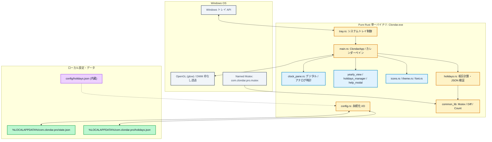

# セルフテスト実施報告書 ＆ システム構成図

[English Version](../en/TEST_REPORT.md) | **日本語版**

## 1. テスト実施結果（セルフテストレポート）

### テスト実施環境
- **OS**: Windows 11 (64-bit)
- **ツールチェイン**: Pure Rust (`rust-version = "1.96.0"`), `eframe 0.37.0` (`egui` + `glow`), NSIS (`makensis`)
- **構成**: 単一プロセスネイティブ GUI、枠なし・影なし・背景透過、システムトレイ常駐、Named Mutex 排他制御

### 検証マトリクス ＆ 結果一覧 (v2.0.0)

| テスト項目ID | テスト対象機能              | 期待される動作                                                                      | 検証結果                                                                                                             | 判定     |
| :----------- | :-------------------------- | :---------------------------------------------------------------------------------- | :------------------------------------------------------------------------------------------------------------------- | :------- |
| TS-001       | Pure Rust 祝日計算エンジン  | 固定・ハッピーマンデー・春分秋分・天皇・振替・国民の休日・特例を正確に算出する      | `cargo test` (`holidays::tests`) の全計算ケースがパス                                                                | **PASS** |
| TS-002       | 内蔵 JSON 整合性・範囲検証  | `config/holidays.json` の読み込みおよび不正月日・週番号（範囲外）をエラー検知する   | `test_default_holidays_json_validity`・`test_validation_error_handling`・`holidays_manager::tests` がパス            | **PASS** |
| TS-003       | `common_lib` 連携ロジック   | LCS テキスト差分計算（`compute_diff`）とキーワード出現集計が正しく動作する          | `test_holidays_diff_logic`・`test_word_count_logic` を含む全 12件の `cargo test` がエラーゼロでパス                  | **PASS** |
| TS-004       | フォーマット ＆ Clippy 解析 | Rust コーディング規約準拠および静的解析警告ゼロであること                           | `cargo fmt --check` および `cargo clippy --all-targets -- -D warnings` が終了コード 0 でパス                         | **PASS** |
| TS-005       | RustDoc 生成確認            | 全モジュール・非公開要素を含むドキュメントビルドがエラーなく完了すること            | `cargo doc --no-deps --document-private-items` が終了コード 0 で完了                                                 | **PASS** |
| TS-006       | 正式リリースバイナリビルド  | `winres` (`build.rs`) でアイコン・メタデータを埋め込み `Clondar.exe` を生成すること | `cargo build --release` が終了コード 0 で完了し、`target/release/Clondar.exe` (**4.89 MB**) を生成                   | **PASS** |
| TS-007       | NSIS インストーラー生成     | 日英対応の NSIS スクリプトが警告・エラーゼロで `setup.exe` を生成すること           | `makensis installer\clondar.nsi` (UTF-8 BOM) が警告 0 で成功し `Clondar_Pro_2.0.0_x64-setup.exe` (**2.59 MB**) 生成  | **PASS** |
| TS-008       | `glow` 移行によるメモリ削減 | `wgpu` ではなく `glow` で単一プロセス・軽量動作すること                             | 2026-11-16 実機計測で 1プロセス・固有メモリ **68.45 MB** を確認（Phase B `190.74 MB` / `wgpu` `293.06 MB` 比大幅減） | **PASS** |

> *(※ Tauri v2 / WebView2 時代のテスト項目 TS-001〜TS-034 の過去履歴は `legacy/tauri-v1` ブランチに保持されています。)*

---

## 2. システム構成図 (Mermaid)

---
**作成日**: 2026年7月10日  
**最終更新日**: 2026年11月16日  
**適合バージョン**: Widget v2.0.0 (Pure Rust Native GUI with egui + glow)
